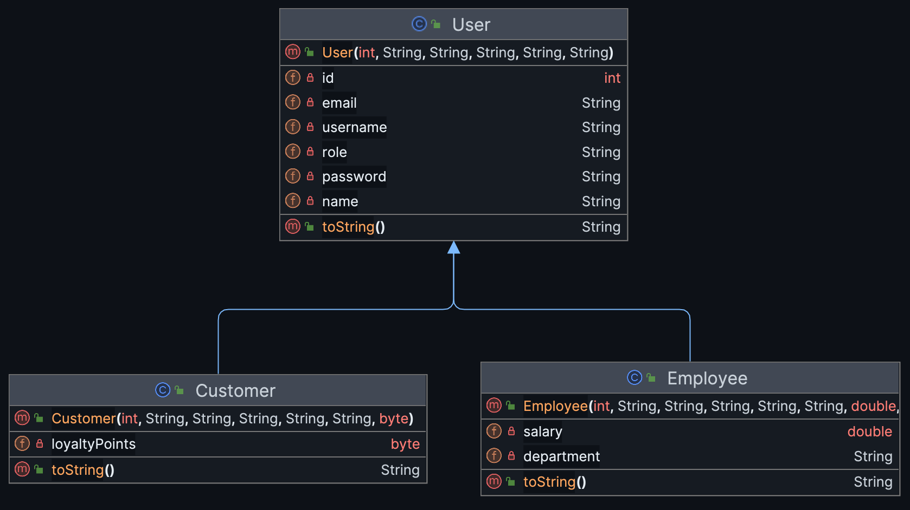
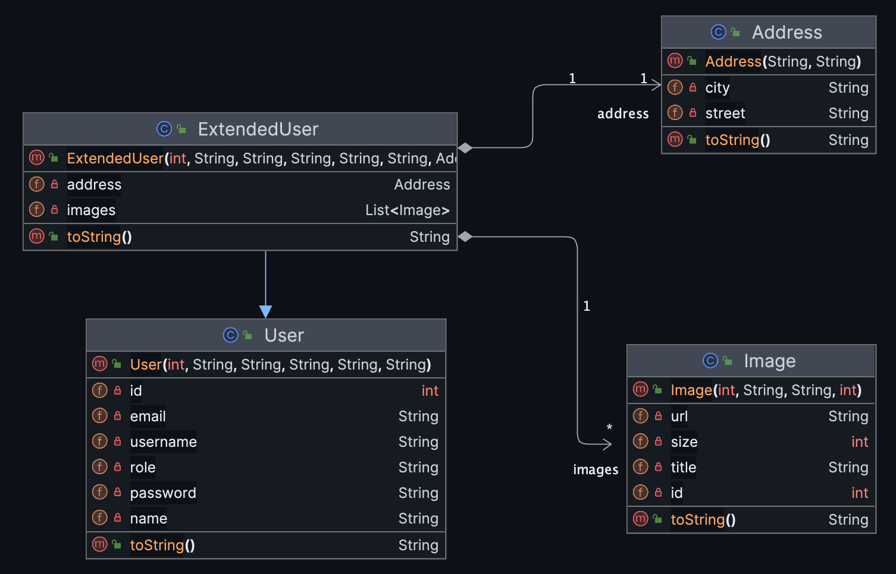
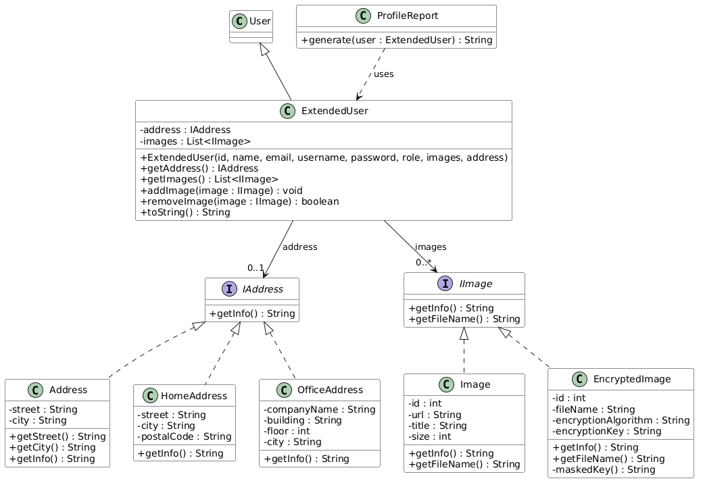

# Hands-on Exercise 1

## Tasks

1. Define a package named `xy.module4.exercises.exercise1`.
2. Download the existing shape application given in `/module4/inheritance/` here.
3. Make the necessary adjustments to include a new Square class.
4. Modify the shape classes to support positioning in a 3-dimensional space. Add a new instance
   variable z for the third dimension and make any necessary changes to methods and constructors.
5. Add a method that calculates the perimeter.
6. Modify the `main()` method accordingly.


***

# Hands-on Exercise 2: Inheritance with User, Customer, and Employee

## Learning Objective
- Understand and practice **inheritance** in Java.
- Model real-world entities into classes and implement relationships.
- Observe how subclasses can extend functionality of a superclass.


## Requirement List
We want to design a system that keeps information about **users**, **customers**, and **employees**.

- A **User** has:
    - `id`
    - `name`
    - `email`
    - `username`
    - `password`
    - `role`

- A **Customer** is a **User** who additionally has:
    - `loyaltyPoints`

- An **Employee** is a **User** who additionally has:
    - `salary`
    - `department`



## Tasks

1. Define a package named `cc.ku.ict.module4.exercises.exercise2`.

2. **Define Classes**
    - `User` (base class)
    - `Customer` (derived class)
    - `Employee` (derived class)

3. **Constructor Chaining**
    - Define constructors.
    - Use `super(...)` in `Customer` and `Employee` to initialize inherited attributes.

4. **Method Overriding**
    - Override `toString()` in `User`, `Customer`, and `Employee` to display relevant object's data.

5. **Testing**
    - Instantiate objects of `User`, `Customer`, and `Employee` in a main method.
    - Print their details.
    - Observe **inheritance** and **method overriding** in action.

## Additional Challenge
- Add a new method in `Customer` to update loyalty points.
- Add a new method in `Employee` to increase salary by a given percentage.
- Test these methods in your main class.
- Generate a UML class diagram that visualizes the classes and their interactions. 

***


# Hands-on Exercise 3: Extending Exercise 2 (User, Customer, and Employee with Associations)

## Learning Objective
- Apply **inheritance** concepts from Exercise 2.
- Practice **association** relationships between classes.
- Understand how objects interact in real-world scenarios.


## Requirement List
Extend the system from **Hands-on Exercise 2** to include additional entities and relationships:

1. Extend the `User` class from Exercise 2 as `ExtendedUser` without modifying the original User class.

2. **Address**
    - Each User has one Address.
    - Use a **unidirectional one-to-one** association: User knows Address, but Address does not know User.

3. **Image**
    - Each User can have multiple images (profile pictures, gallery).
    - Use a **unidirectional one-to-many** association: User knows its Images.




## Tasks

1. Define a package named `cc.ku.ict.module4.exercises.exercise3`.
2. Extend the `User` class from Exercise 2 as `ExtendedUser` without modifying the original User class.

2. **Enhance Classes**
    - Add `Address` class.
    - Update `ExtendedUser` to include a single `Address`.
    - Add `Image` class with attributes id,url,title, and size, including relevant methods.
    - Update `ExtendedUser` to include multiple `Image` objects.

2. **Constructor and toString**
    - Use constructor chaining with `super(...)` for derived class.
    - Override `toString()` methods to include association info.

3. **Testing**
    - Instantiate an ExtendedUser object.
    - Assign an Address to the user.
    - Assign multiple Images to the user.
    - Print all objects to show inherited properties and associations.
   
4. Debug your application using an appropriate debugger. Your debugging should include:

- At least one **breakpoint** 
- Use of **Step Over**, **Step Into**, and **Step Out**
- Inspection of variables using the **Variables panel** or **Watches**


## Additional Challenge
- Add methods to add/remove Images from a ExtendedUser.
- Print ExtendedUser details to see all associated Address and Images.


# Hands-on Exercise 4: Building an Extensible User Profile System

## Scenario

You are working on a **user profile module** for a social platform. Each user has one address and a collection of 
profile images. The address format is stable and will not change. The product team, however, has announced that new 
kinds of images (encrypted now, cloud-hosted and others later) will be added over the next releases.

Your job is to design the module so that **new image types can be added without modifying existing, tested code**.



## Learning Objectives

After completing this exercise, you should be able to:

- Reinforce inheritance and association from Exercise 3.
- Use **polymorphism** to treat different image types through one interface.
- Decide **where an interface is worth introducing** and where a concrete class is enough.
- Apply the **Dependency Inversion Principle (DIP)**: high-level classes depend on abstractions, not on concrete classes.
- Apply the **Open/Closed Principle (OCP)**: add new behaviour by adding new classes.
- Apply the **Single Responsibility Principle (SRP)**: separate data from reporting.


## Design Principles

| Principle | Explanation                                                                                    |
|---|------------------------------------------------------------------------------------------------|
| **SRP** | A class should have only one reason to change.                                                 |
| **OCP** | Modules should be open for extension, but closed for modification.                             |
| **DIP** | High-level modules should not depend on low-level modules; both should depend on abstractions. |

## Part 1: Refactor Exercise 3

1. Copy all files from Exercise 3 into the package `cc.ku.ict.module4.exercises.exercise4`.

2. Define the `IImage` interface and update the existing classes:

   | Type | Methods | Notes |
      |---|---|---|
   | `IImage` (interface) | `String getInfo()`, `String getFileName()` | New |
   | `Image` | implements `IImage` | Update |
   | `Address` (concrete class) | add `String getInfo()` | No interface: addresses are stable and will not change |

3. Update `ExtendedUser`:
   - One-to-one, unidirectional association with `Address`.
   - One-to-many, unidirectional association with `List<IImage>`.
   - No import or mention of `Image` anywhere in `ExtendedUser`.
   - `addImage(IImage image)` and `removeImage(IImage image)`; reject `null` values.
   - The class must **own its list**: copy the list passed to the constructor, and do not return the internal list from `getImages()`.

4. Use constructor chaining: call `super(...)` for inherited properties, and initialize `address` and the `images` list in the derived class.

5. Override `toString()` in all classes as a **debugging aid**. In `ExtendedUser`, call `getInfo()` on the address 
and on every `IImage`; do not check the concrete type.

## Part 2: Separate Reporting (SRP)

`ExtendedUser` stores data. It should not be responsible for producing user-facing reports. 
Define a class named `ProfileReport`:

```java
public class ProfileReport {
    public String generate(ExtendedUser user) { ... }
}
```

The report must list the user's name, email, address info, and the info of each image. It must work for **any** 
`IImage` implementation through polymorphism, with no `instanceof` checks and no casting.

## Part 3: Extend Without Modifying (OCP)

The product team requests a new image type. Implement it **only by adding a new class**.

`EncryptedImage` implements `IImage`:

- Attributes: `encryptionAlgorithm`, `encryptionKey`.
- `getInfo()` must show the file name and the algorithm. **Do not print the full key**: show only a masked version, 
e.g. `****a9f2`.

> **Rule:** `ExtendedUser`, `ProfileReport`, `Address`, `Image`, and `IImage` must remain **unchanged** during Part 3.

## Part 4: Testing

Write a `Main` (or test) class that:

1. Instantiate at least **two** `ExtendedUser` objects with different `Address` objects.
2. Gives each user a **mix** of `Image` and `EncryptedImage` objects, declared as `IImage`.
3. Prints each user with `toString()` and with `ProfileReport.generate(...)`.
4. Calls `removeImage()` on one user and prints the report again to show the change.

**Expected output (example format only):**

```text
User: Ali Karimov (ali@example.com)
Address: 12 Abay St, Petropavl
Images (2):
  1. photo1.jpg - https://example.com/photo1.jpg, 340 KB
  2. passport.png - encrypted (AES-256), key: ****a9f2
```


## Additional Challenge

- Add a `CloudImage` class (attributes: `bucket`, `objectKey`) that implements `IImage`, and add one to a user in `Main`. Confirm that no existing file changed.
- Debugging: Use the IntelliJ debugger on your test program. Set a breakpoint in `ProfileReport.generate()` and:
  - Step through the loop over `images` and observe how the runtime type of each element changes.


## Reflection Questions


1. Which class is the **high-level** module and which are the **low-level** modules? Where does the dependency arrow point after applying DIP?
2. Why is there an interface for images but not for addresses? Under what circumstances would you introduce `IAddress` later, and what would it cost?
3. What would you have had to change in `ExtendedUser` if you had **not** used `IImage` when `EncryptedImage` was added?
4. Where in your code does polymorphism happen? Point to a specific line.
5. Why is `ProfileReport` a separate class instead of a method inside `ExtendedUser`? What change would affect only `ProfileReport`?
