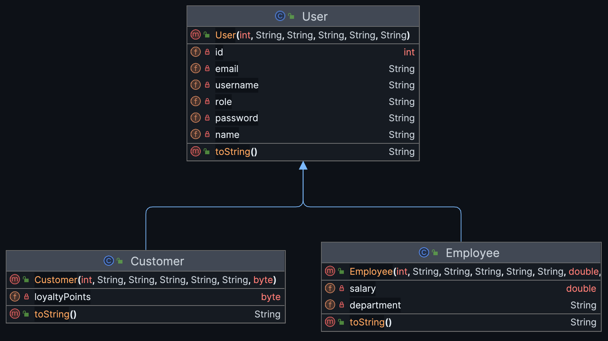
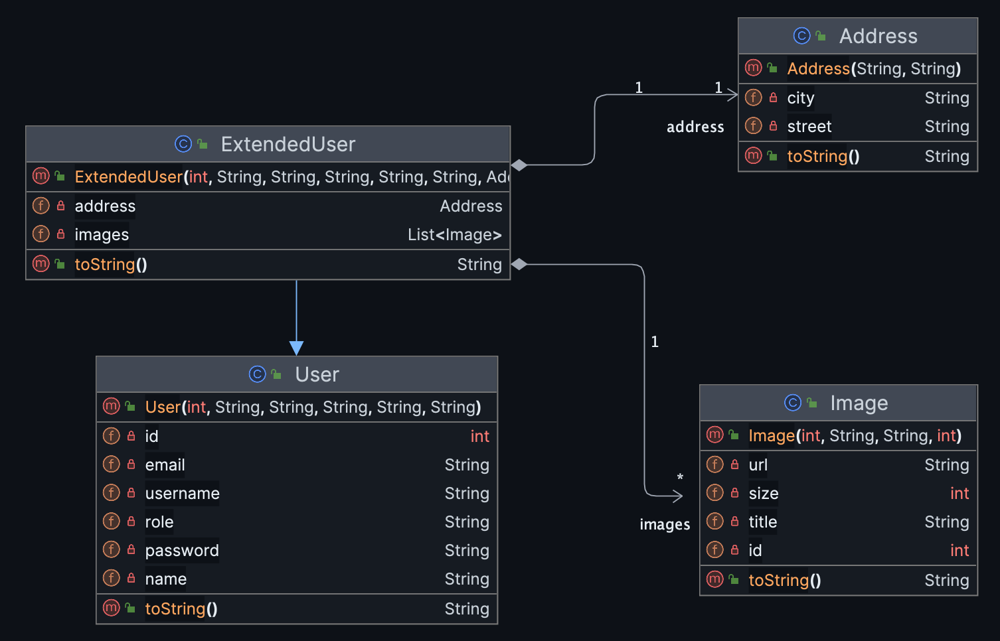

# Hands-on Exercise 1

## Tasks

1. Define a package named `xy.module4.exercises.exercise1`.
2. Download the existing shape application given in `/module4/inheritance/` here.
3. Make the necessary adjustments to include a new Square class.
4. Modify the shape classes to support positioning in a 3-dimensional space. Add a new instance
   variable z for the third dimension and make any necessary changes to methods and constructors.
5. Add a method that calculates the perimeter.
6. Modify the `main()` method accordingly.

***

# Hands-on Exercise 2: Inheritance with User, Customer, and Employee

## Learning Objective
- Understand and practice **inheritance** in Java.
- Model real-world entities into classes and implement relationships.
- Observe how subclasses can extend functionality of a superclass.

## Requirement List
We want to design a system that keeps information about **users**, **customers**, and **employees**.

- A **User** has:
    - `id`
    - `name`
    - `email`
    - `username`
    - `password`
    - `role`

- A **Customer** is a **User** who additionally has:
    - `loyaltyPoints`

- An **Employee** is a **User** who additionally has:
    - `salary`
    - `department`

## Tasks

1. Define a package named `cc.ku.ict.module4.exercises.exercise2`.

2. **Define Classes**
    - `User` (base class)
    - `Customer` (derived class)
    - `Employee` (derived class)

3. **Constructor Chaining**
    - Define constructors.
    - Use `super(...)` in `Customer` and `Employee` to initialize inherited attributes.

4. **Method Overriding**
    - Override `toString()` in `User`, `Customer`, and `Employee` to display relevant object's data.

5. **Testing**
    - Instantiate objects of `User`, `Customer`, and `Employee` in a main method.
    - Print their details.
    - Observe **inheritance** and **method overriding** in action.

## Additional Challenge
- Add a new method in `Customer` to update loyalty points.
- Add a new method in `Employee` to increase salary by a given percentage.
- Test these methods in your main class.
- Generate a UML class diagram that visualizes the classes and their interactions. 

***

# Hands-on Exercise 3: Extending Exercise 2 (User, Customer, and Employee with Associations)

## Learning Objective
- Apply **inheritance** concepts from Exercise 2.
- Practice **association** relationships between classes.
- Understand how objects interact in real-world scenarios.

## Requirement List
Extend the system from **Hands-on Exercise 2** to include additional entities and relationships:

1. Extend the `User` class from Exercise 2 as `ExtendedUser` without modifying the original User class.

2. **Address**
    - Each User has one Address.
    - Use a **unidirectional one-to-one** association: User knows Address, but Address does not know User.

3. **Image**
    - Each User can have multiple images (profile pictures, gallery).
    - Use a **unidirectional one-to-many** association: User knows its Images.

## Tasks

1. Define a package named `cc.ku.ict.module4.exercises.exercise3`.
2. Extend the `User` class from Exercise 2 as `ExtendedUser` without modifying the original User class.

2. **Enhance Classes**
    - Add `Address` class.
    - Update `ExtendedUser` to include a single `Address`.
    - Add `Image` class with attributes id,url,title, and size, including relevant methods.
    - Update `ExtendedUser` to include multiple `Image` objects.

2. **Constructor and toString**
    - Use constructor chaining with `super(...)` for derived class.
    - Override `toString()` methods to include association info.

3. **Testing**
    - Instantiate an ExtendedUser object.
    - Assign an Address to the user.
    - Assign multiple Images to the user.
    - Print all objects to show inherited properties and associations.

## Additional Challenge
- Add methods to add/remove Images from a ExtendedUser.
- Print ExtendedUser details to see all associated Address and Images.

