# Module 5: Database Management Systems (DBMS)

<!-- TOC -->
* [Module 5: Database Management Systems (DBMS)](#module-5-database-management-systems-dbms)
  * [1. Introduction to Database Management Systems (DBMS)](#1-introduction-to-database-management-systems-dbms)
  * [2. Data and Information](#2-data-and-information)
  * [3. Database System](#3-database-system)
  * [4. Essential Features of a Database Management System (DBMS)](#4-essential-features-of-a-database-management-system-dbms)
  * [5. Some Well-Known Relational Database Management Systems (RDBMS)](#5-some-well-known-relational-database-management-systems-rdbms)
  * [6. Some Well-Known NoSQL Database Management Systems (NoSQL DBMS)](#6-some-well-known-nosql-database-management-systems-nosql-dbms)
  * [7. Setting up the development environment](#7-setting-up-the-development-environment)
    * [PostgreSQL (for relational DB Operations)](#postgresql-for-relational-db-operations)
    * [Designing ER diagrams](#designing-er-diagrams)
    * [MongoDB (for NoSQL DB Operations)](#mongodb-for-nosql-db-operations)
    * [IntelliJ IDEA (for Java-Based Program Development)](#intellij-idea-for-java-based-program-development)
  * [8. Database Development Lifecycle](#8-database-development-lifecycle)
    * [1. Requirement Analysis](#1-requirement-analysis)
    * [2. Design](#2-design)
    * [3. Implementation](#3-implementation)
    * [4. Maintenance](#4-maintenance)
  * [9. Business Rules](#9-business-rules)
  * [10. Data Model: Entity–Relationship (ER) Model](#10-data-model-entityrelationship-er-model)
    * [Benefits of Data Modeling](#benefits-of-data-modeling)
    * [The Data Modeling Process](#the-data-modeling-process)
    * [Key Components of a Data Model](#key-components-of-a-data-model)
  * [11. Relational Databases and Basic SQL](#11-relational-databases-and-basic-sql)
    * [Terminology](#terminology)
    * [Setting Up the Working Environment](#setting-up-the-working-environment)
      * [Importing and Exporting Sample Database](#importing-and-exporting-sample-database)
    * [Basic Structured Query Language (SQL)](#basic-structured-query-language-sql)
      * [CREATE DATABASE](#create-database)
      * [CREATE TABLE](#create-table)
      * [SELECT](#select)
      * [INSERT INTO](#insert-into)
      * [UPDATE](#update)
      * [DELETE](#delete)
  * [12. NoSQL Databases](#12-nosql-databases)
    * [Comparison with Relational DB:](#comparison-with-relational-db)
    * [Main Types of NoSQL Databases](#main-types-of-nosql-databases)
    * [1.3 MongoDB NoSQL Database](#13-mongodb-nosql-database)
      * [Two Key Structures in a Cluster](#two-key-structures-in-a-cluster)
  * [13. Using a Programming Language to Interact With a Database](#13-using-a-programming-language-to-interact-with-a-database)
    * [Database Drivers – Core Functions](#database-drivers--core-functions)
    * [Initializing A New Project Using IntelliJ IDEA for Java-Based Program Development](#initializing-a-new-project-using-intellij-idea-for-java-based-program-development)
      * [Loading Database Driver Into The Project Environment](#loading-database-driver-into-the-project-environment)
    * [Database Operations with Java and PostgreSQL](#database-operations-with-java-and-postgresql)
      * [Example Workflow (Conceptual)](#example-workflow-conceptual)
    * [Database Operations with Java and MongoDB](#database-operations-with-java-and-mongodb)
      * [Example Workflow (Conceptual)](#example-workflow-conceptual-1)
  * [Hands-on Exercise](#hands-on-exercise)
<!-- TOC -->


## 1. Introduction to Database Management Systems (DBMS)

* A **database** is a persistent and organized collection of related data designed for efficient storage, retrieval,
  manipulation, management, and protection.
* A **Database Management System (DBMS)** is specialized software that controls and manages databases and
  provides interfaces for database clients to store, retrieve, and manipulate data efficiently.


As applications grow in size and complexity, managing data directly through files and in-memory structures becomes
inefficient, error-prone, and difficult to scale. A Database Management System (DBMS) provides a systematic way to
store, organize, retrieve, and protect large volumes of persistent data while ensuring efficiency, consistency,
security, and concurrent access by multiple users and applications. By abstracting low-level storage details and
optimizing data access, a DBMS enables programs to focus on problem-solving logic rather than data handling, making
it an essential component of modern software systems.

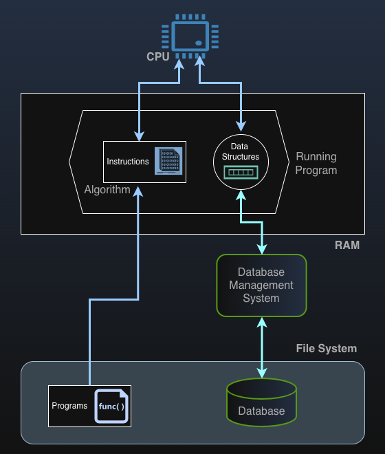


In summary:
* Data originates from the problem domain.
* Programs process it using algorithms, executed by the CPU.
* Data is temporarily stored in RAM as data structures.
* Fast access is provided by RAM.
* Persistent, structured, and shared data is managed by a DBMS, which ensures long-term retention.


## 2. Data and Information

- Raw facts that have not been processed or given meaning are referred to as **data**.
- When data is processed, organized, or interpreted, it is transformed into meaningful **information**.
- **Information** represents the meaning derived from data and provides context.
- Context is obtained by associating data with other related data.

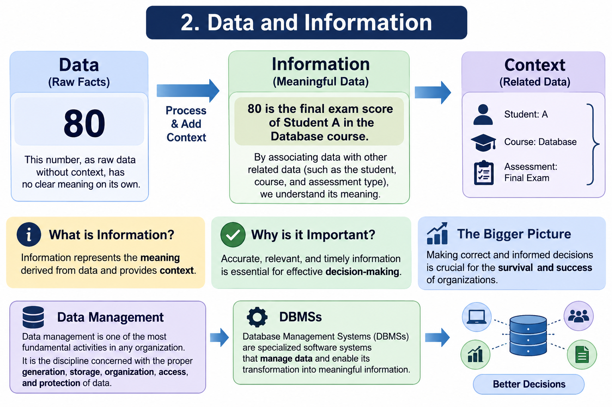

**Example:**

> 80

This number, as raw data without context, has no clear meaning on its own.

> 80 is the final exam score of Student A in the Database course.

By associating it with other data (such as the student, course, and assessment type),
we provide **context**, allowing us to understand its meaning as information.

- Accurate, relevant, and timely information is essential for effective **decision-making**.
- Making correct and informed decisions is crucial for the **survival and success of organizations**.
- **Data management** is one of the most fundamental activities in any organization.
- Data management is the discipline concerned with the proper **generation, storage, organization, access, and
  protection** of data.


***Database Management Systems (DBMSs) are specialized software systems that also help transform data into meaningful information.***


## 3. Database System
A **Database System** consists of three main parts:
- **Database** = Raw Data + Metadata (used to define relationships and data characteristics, forming the logical
  structure of the database).
- **DBMS (Database Management System)**
- **Database clients** = Application software or database client tools that interact with the DBMS.

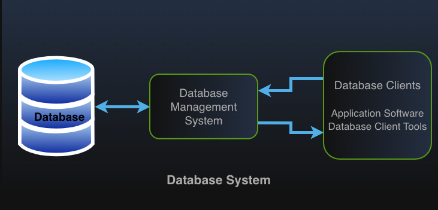

---


## 4. Essential Features of a Database Management System (DBMS)

- **Data Integration**  
  Efficiently manages and organizes data to avoid unnecessary duplication, which can lead to anomalies in insert,
  update, and delete operations.
  - *Relational DBMSs* enforce structured relationships among data.
  - *NoSQL systems* focus on flexible data organization to handle diverse and evolving data types.

- **Data Integrity**  
  Ensures that data remains accurate, consistent, and reliable over time.
  - *Relational DBMSs* enforce integrity through schemas and constraints, such as primary and foreign keys.
  - *NoSQL systems* often relax these rules to achieve higher performance and scalability.

- **Data Security**  
  Protects data from unauthorized access, system failures, and attacks.
  - Both SQL and NoSQL systems implement mechanisms such as authentication, authorization, and backup, though
    implementation methods may differ.

- **Data Abstraction**  
  Provides a logical view of data, hiding the complexity of underlying storage structures.
  - *Relational DBMSs* organize data in tables with defined schemas.
  - *NoSQL systems* use alternative models such as key-value stores, documents, wide-column stores, or graphs.


---

## 5. Some Well-Known Relational Database Management Systems (RDBMS)

- **PostgreSQL** – An advanced open-source RDBMS with strong support for SQL and some NoSQL features, known for data integrity, extensibility, and reliability.
- **MySQL** – An open-source RDBMS known for its speed, ease of use, and reliability, widely used in web applications and data-driven platforms.
- **Oracle Database** – A commercial RDBMS used in enterprise applications, offering high performance, strong security, and scalability.
- **Microsoft SQL Server** – A robust RDBMS from Microsoft, widely used in business applications and tightly integrated with Windows environments.
- **SQLite** – A lightweight, embedded RDBMS often used in mobile applications and local storage, without requiring a separate server.
- **IBM Db2** – A high-performance RDBMS designed for large-scale enterprise applications, offering AI-driven optimizations.
- **MariaDB** – A MySQL-compatible open-source database known for enhanced performance, security, and scalability.

---

## 6. Some Well-Known NoSQL Database Management Systems (NoSQL DBMS)

- **MongoDB** – A popular document-oriented database that stores data in flexible JSON-like documents, ideal for dynamic and evolving datasets.
- **Cassandra** – A highly scalable wide-column store designed for handling large volumes of distributed data across multiple nodes with high availability.
- **Redis** – An in-memory key-value store known for extreme speed, used for caching, real-time analytics, and messaging.
- **Couchbase** – A distributed NoSQL document database combining key-value access with flexible queries and full-text search capabilities.
- **Neo4j** – A graph database optimized for storing and querying highly connected data, widely used in social networks and recommendation engines.
- **Amazon DynamoDB** – A fully managed key-value and document database service offered by AWS, known for automatic scaling and high availability.
- **Firebase Realtime Database** – A cloud-hosted NoSQL database for real-time synchronization in mobile and web applications.

---

## 7. Setting up the development environment

To practice throughout this course, install/register/configure the following tools:

---

### PostgreSQL (for relational DB Operations)
- PostgreSQL is an open-source and powerful relational database management system.
- Complies with SQL standards and supports Linux, macOS, and Windows.
- Download Link: [Download PostgreSQL](https://www.postgresql.org/download/) any version that can
  be installed without issues.

---

### Designing ER diagrams

Draw.io (now also known as diagrams.net) is a free and web-based diagramming tool used to design Entity Relationship(ER)  
models.

* https://app.diagrams.net/

---


### MongoDB (for NoSQL DB Operations)

You can use MongoDB Cloud (https://account.mongodb.com/account/login
) without installation, or install MongoDB on your computer from the following
link: https://www.mongodb.com/try/download/community

---

### IntelliJ IDEA (for Java-Based Program Development)

## 8. Database Development Lifecycle

The **Database Development Lifecycle** is a structured process used to design and build high-quality databases in a 
systematic and efficient way. It breaks database development into distinct phases, each with specific goals and 
deliverables. 

The Database Development Lifecycle typically consists of four fundamental phases.


### 1. Requirement Analysis
- Identify and document **business needs**, **processes**, and **data requirements**.
- Define **business rules** that govern how data should be used and constrained.

**Roles Involved:** Business Analysts, Project Managers, Stakeholders/Clients  
**Output:** Requirements Specification Document


### 2. Design
- Develop the **data model** to represent entities, attributes, and relationships (ER Diagram).
- Convert the conceptual model into a **logical schema** with **tables, columns, primary/foreign keys, and constraints**.
- Ensure that the design supports business rules, normalization, and integrity requirements.

**Roles Involved:** Data Architects, Database Designers, Data Modelers  
**Output:** Database Design Document (ER Diagram + Logical Schema)


### 3. Implementation
- Build and configure the database using **DBMS tools and SQL (or NoSQL commands)**.
- Populate the database with initial data and test for **structural integrity and performance**.

**Roles Involved:** Database Developers, Database Administrators (DBAs)  
**Output:** Operational Database


### 4. Maintenance
- Monitor database performance and ensure **availability, security, and reliability**.
- Apply **updates, optimizations, and patches** as needed.
- Handle **data backup, recovery, and tuning** tasks over time.

**Roles Involved:** Database Administrators (DBAs), System Administrators  
**Output:** Stable, Optimized, and Secure Database System


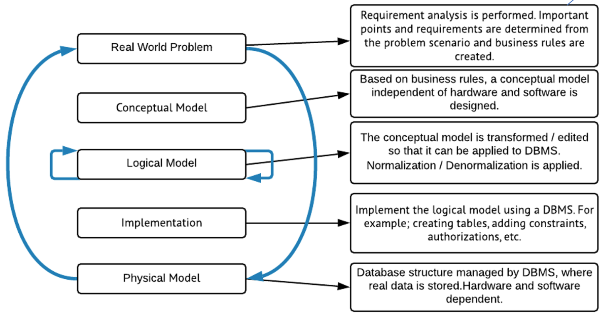


## 9. Business Rules

Specific statements that define or constrain business data and operations. They often originate from 
requirement list.

* Data-oriented business rules → Define how data is structured and related (e.g., entities, attributes, relationships, 
constraints). They are used to design and build the database.
* Process-oriented business rules → Define business actions or workflows (e.g., approval steps, procedures). They are
  implemented in application logic, not database structure.

**Sources of Business Rules**

- **End users**
- **Managers and policymakers**
- **Written documentation** such as standards, regulations, and procedures

Direct interaction with **end users** ensures a clearer understanding of actual data needs and system expectations.

**Examples of Business Rules**

- An employee can belong to only one department.
- A customer must provide a valid email.
- A student can enroll in many courses, and a course can have many students.
- An order must include at least one product.
- A customer can place multiple orders, but each order is placed by only one customer.

Data-oriented business rules help identify **entities, attributes, relationships, and constraints** 
when developing the **Entity-Relationship (ER) model**.  

Once these rules are defined, the next step is to **model the database** to implement them effectively.


## 10. Data Model: Entity–Relationship (ER) Model

A **data model** is a conceptual tool used to represent complex real-world data structures in a simplified, often **graphical**, form.

### Benefits of Data Modeling
1. **Improves Communication**
  - Promotes clear communication between database designers, developers, and end users. 
  - Ensures that all stakeholders share a common understanding of the data structure before implementation.
2. **Guides Database Implementation**
  - Directs the database development process and reduces implementation errors.

### The Data Modeling Process
Data modeling is an **iterative** process:
1. A **basic model** is designed first.
2. **Details** are gradually added.
3. The model evolves into a **complete blueprint** for database design.

### Key Components of a Data Model

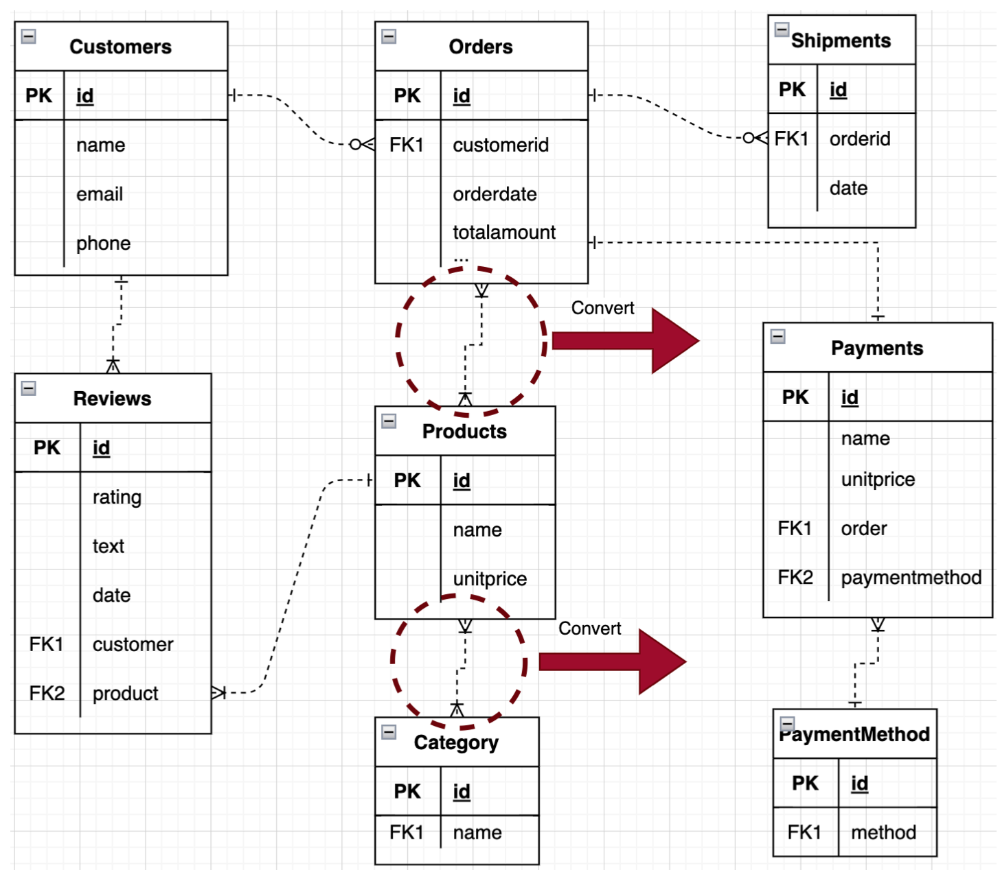

- **Entities** – Represent real-world objects about which data is collected (e.g., `Student`, `Course`, `Employee`).
- **Attributes** – Describe properties or characteristics of entities (e.g., `Name`, `ProductCode`, `UnitPrice`).
- **Relationships** – Define associations between entities. Common types include:
  - **One-to-Many (1:M)**
  - **Many-to-Many (M:N)**
  - **One-to-One (1:1)**
- **Constraints** – Define rules that preserve data accuracy and consistency, for example:
  - An employee’s age must be between 18 and 65.
  - A phone number must follow the format `(XXX) XXX-XXXX`.
  - Each email address must be unique in the system.

> **In summary:**  
> Business rules form the foundation of the data model, and the ER model visualizes these rules to form the conceptual and 
logical structure of the database.


## 11. Relational Databases and Basic SQL

The **relational model** organizes data into **tables (relations)** consisting of **rows (tuples)** and **columns
(attributes)**.

It is based on solid mathematical foundations (set theory and predicate logic) and is the most widely used data model
in database systems.

Relationships established using **keys**:
  - **Primary Key** → unique identifier of a row.
  - **Foreign Key** → links rows between tables.

**SQL (Structured Query Language)** is the standard language for relational databases.


### Terminology

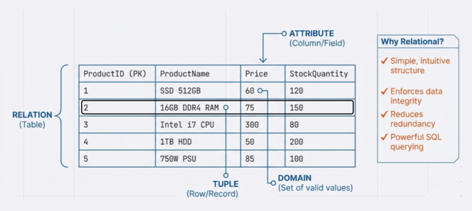

- **Relation**:  
  A table composed of rows and columns.

- **Tuple**:  
  A single row in a table representing one record.

- **Attribute**:  
  A column in a table representing a specific data field.

- **Domain**:  
  The set of valid values that an attribute can take (e.g., integers, dates, predefined ranges).


### Setting Up the Working Environment

To work with relational databases efficiently, a proper working environment is required.

#### Importing and Exporting Sample Database

* **Northwind Sample Database**
  - A well-known example database that represents the data structure of a trading company.
  - Can be imported using **pgAdmin**.
  - [Download](../resources/dbs/northwind.backup)


### Basic Structured Query Language (SQL)

SQL is the standard language for managing and querying relational databases.

SQL is used to interact with relational database management systems (RDBMS).

SQL functions can be divided into two main categories:

**1. Data Definition Language (DDL)** – Structural Commands
DDL includes commands that define and modify database structures:
- Defining, altering, and deleting database objects such as **database, table, view, function, etc.**.

**2. Data Manipulation Language (DML)** – Data Processing Commands
DML includes commands that manipulate data within tables:
- Inserting, deleting, updating, and retrieving(querying) **data**.


| Command             | Description                             |
|---------------------|-----------------------------------------|
| **CREATE DATABASE** | Constructs a new database.              |
| **CREATE TABLE**    | Defines a new table.                    |
| **SELECT**          | Retrieves data from one or more tables. |
| **INSERT**          | Adds new data into a table.             |
| **UPDATE**          | Modifies existing records in a table.   |
| **DELETE**          | Removes specific records from a table.  |


#### CREATE DATABASE

Constructs a new database.

```sql
CREATE DATABASE ecommercedb
```

#### CREATE TABLE

Defines a new table.

```sql
CREATE TABLE products (  
    id SERIAL,
    code CHAR(6) NOT NULL,
    name VARCHAR(40) NOT NULL,
    date DATE DEFAULT '2019-01-01',
    price MONEY,
    quantity SMALLINT DEFAULT 0,
    CONSTRAINT "productsPK" PRIMARY KEY(id),
    CONSTRAINT "productsUnique" UNIQUE(code),
    CONSTRAINT "productsCheck" CHECK(quantity >= 0)
);

```

---
**The following queries are based on the Northwind sample database.**

---


#### SELECT

The **SELECT** statement is used to retrieve data from the database (searching/listing).

```sql
SELECT * FROM "customers" WHERE "Country"='Spain' OR "Country"='Türkiye'
ORDER BY "CustomerID";
```


In the relational model, meaningful data is distributed across related tables to avoid redundancy.

To retrieve meaningful information, data from these tables must often be combined using **SQL JOIN** operations.

**JOIN operations** are used to combine rows from two or more tables based on a related column.


**INNER JOIN**

An **INNER JOIN** returns only the rows that have **matching values in both tables**.

* A row will appear in the result **only if the related row exists in the other table**.
* If a row in one table does **not** have a corresponding row in the other table, it **does not appear in the result**.


- Only products with a valid `CategoryID` in the **Categories** table are included.
- Any product with a `NULL` `CategoryID` is excluded.

```sql
SELECT "ProductID", "ProductName", "CategoryName"
FROM "products"
INNER JOIN "categories" ON "products"."CategoryID" = "categories"."CategoryID";
```

#### INSERT INTO

>***Data integrity constraints are enforced when insert, update, and delete statements are executed. If a data
integrity violation occurs, the operation is aborted, ensuring that data remains consistent and accurate.***


Add new records to a table.
- It is possible to insert values into only specific columns.
- Columns that are not explicitly assigned a value will be set to **NULL** (empty).

```sql
INSERT INTO "customers" 
("CustomerID", "CompanyName", "ContactName", "Address", "City", "Country") 
VALUES ('X1', 'ABC', 'Jane', 'Address1', 'Astana', 'Kazakhstan');
```


#### UPDATE

The **UPDATE** statement is used to modify existing records in a table.
- The `WHERE` clause is used to specify which records should be updated.
- If the `WHERE` clause is **not** included, **all rows** in the table are updated.


```sql
UPDATE "customers"
SET "ContactName" = 'Jane Lee',
    "City" = 'Astana'
WHERE "CustomerID" = '1';

```

#### DELETE

The **DELETE** statement is used to remove one or more records from a table.
- The `WHERE` clause specifies which records should be deleted.
- If the `WHERE` clause is **not** included, **all records** in the table are deleted.


```sql
DELETE FROM "customers"
WHERE "CustomerID" = '1';
```


## 12. NoSQL Databases
- **NoSQL** (AKA Not Only SQL) databases are  designed for scalability, flexibility, and high-performance.
- They are capable of handling large-scale, unstructured, semi-structured, and rapidly changing data.

### Comparison with Relational DB:

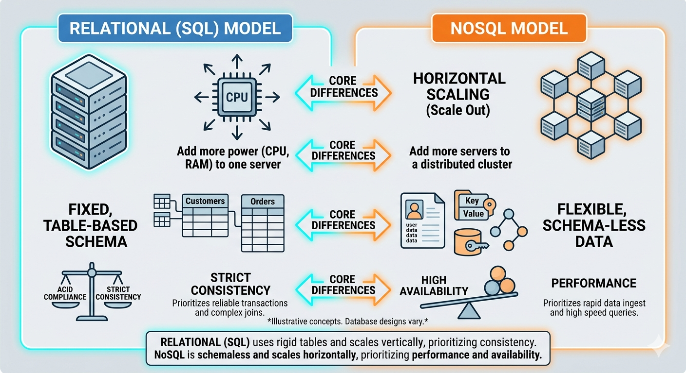


>**Vertical scaling is limited by the maximum physical capacity of a single machine, whereas horizontal scaling is
> theoretically limitless because you can infinitely add more standard servers to a distributed cluster.**
>

### Main Types of NoSQL Databases

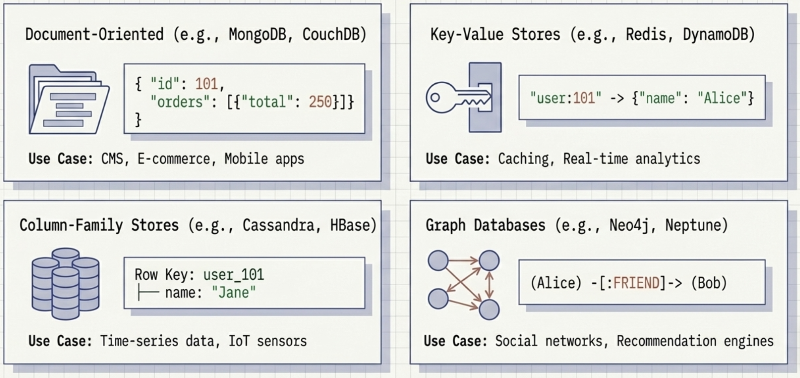


1. **Document-Oriented Databases**
- Store data as documents (usually in JSON or BSON format).
- Each document can have a flexible structure.
- **Examples:** MongoDB, CouchDB, Firebase Firestore
- **Sample:**
  ```json
  {
    "id": 101,
    "name": "Jane Lee",
    "email": "jl@email.com",
    "orders": [
      { "orderId": 1, "total": 250 },
      { "orderId": 2, "total": 180 }
    ]
  }
  ```
- **Used in:**
    - Content management systems (CMS)
    - E-commerce product catalogs
    - Mobile and web apps with dynamic data structures

2. **Key–Value Stores**
- Store data as key–value pairs (like a dictionary or map).
- Very fast for lookups and caching.
- **Examples:** Redis, Amazon DynamoDB, Riak
- **Sample:**
  ```
  "user:101" -> { "name": "Alice", "balance": 300 }
  "user:102" -> { "name": "Bob", "balance": 450 }
  ```
- **Used in:**
    - Caching user sessions
    - Real-time analytics and leaderboards
    - High-speed transaction systems

3. **Column-Family Stores**
- Organize data into columns and column families instead of rows.
- Designed for high performance and scalability across distributed systems.
- **Examples:** Apache Cassandra, HBase, ScyllaDB
    - **Sample:**
      ```
      UserProfiles (Column Family)
      └── Row Key: user_101
          ├── name: "Jane"
          ├── email: "jane@email.com"
          └── country: "Kazakhstan"
    
      └── Row Key: user_102
          ├── name: "Jack"
          └── email: "jck@email.com"

      Customer (Column Family)
      └── Row Key: user_101
          ├── name: Alice
          ├── email: alice@email.com
          └── orders: [1, 2, 3]
      ```
- **Used in:**
    - Time-series data storage
    - IoT and sensor data collection
    - Large-scale analytics applications

4. **Graph Databases**
- Represent data as nodes (entities) and edges (relationships).
- Ideal for analyzing complex, interconnected data.
- **Examples:** Neo4j, Amazon Neptune, ArangoDB
- **Sample (relationships):**
  ```
  (Alice) -[:FRIEND]-> (Bob)
  (Alice) -[:PURCHASED]-> (Product_A)
  (Bob) -[:PURCHASED]-> (Product_B)
  ```
- **Used in:**
    - Social networking platforms
    - Recommendation engines
    - Fraud detection and knowledge graphs


### 1.3 MongoDB NoSQL Database

MongoDB is a popular NoSQL database that stores data in a flexible, document-oriented format instead of the traditional
table-and-row structure used by relational databases. Data is organized into collections, and each collection contains
documents represented in BSON (Binary JSON). Because documents can have varying structures, MongoDB is schema-less,
allowing applications to evolve without modifying fixed table definitions.

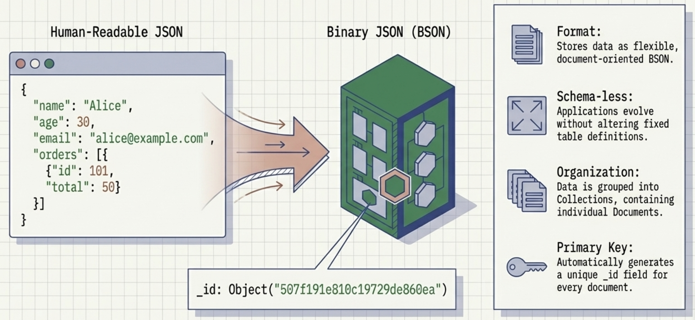


One of MongoDB’s key strengths is its ability to handle large volumes of unstructured or semi-structured data while
maintaining high performance. It offers rich querying capabilities, indexing, and aggregation tools similar to SQL
features but designed for flexible document data. MongoDB also provides automatic generation of a unique _id field
for each document, acting like a primary key.

MongoDB is designed for scalability and reliability. It supports replication for high availability and sharding for
horizontal scaling across multiple servers, making it suitable for modern distributed systems. Thanks to its
flexibility, scalability, and ease of use, MongoDB is widely used in web applications, real-time analytics, IoT
systems, and any environment where data structure can change over time.

A cluster is a group of interconnected servers (nodes) that work
together as a single unified database system, providing:
- Scalability
- Redundancy
- High availability

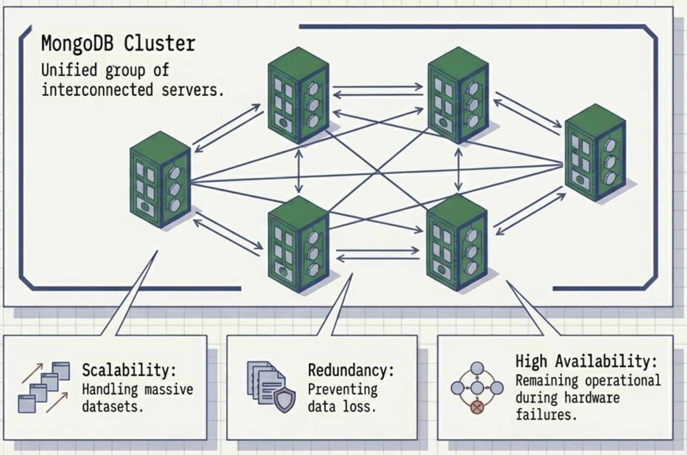

---

#### Two Key Structures in a Cluster

1) **Replica Set**

Provides  redundancy and high availability.

The same data is copied across multiple nodes.

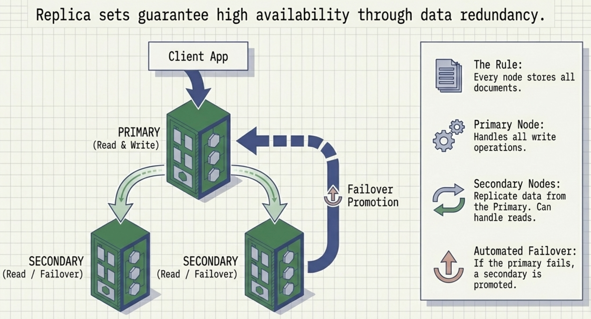


- One **Primary** node handles all writes
- One or more **Secondary** nodes replicate data from the primary
- If the primary fails, a secondary is **automatically promoted** to primary

>**In a replica set, read performance can also be improved by directing read operations to the nearest replica node.**

---

2) **Sharding**

Provides **horizontal scalability**.

Large datasets are split and distributed across multiple (shards).

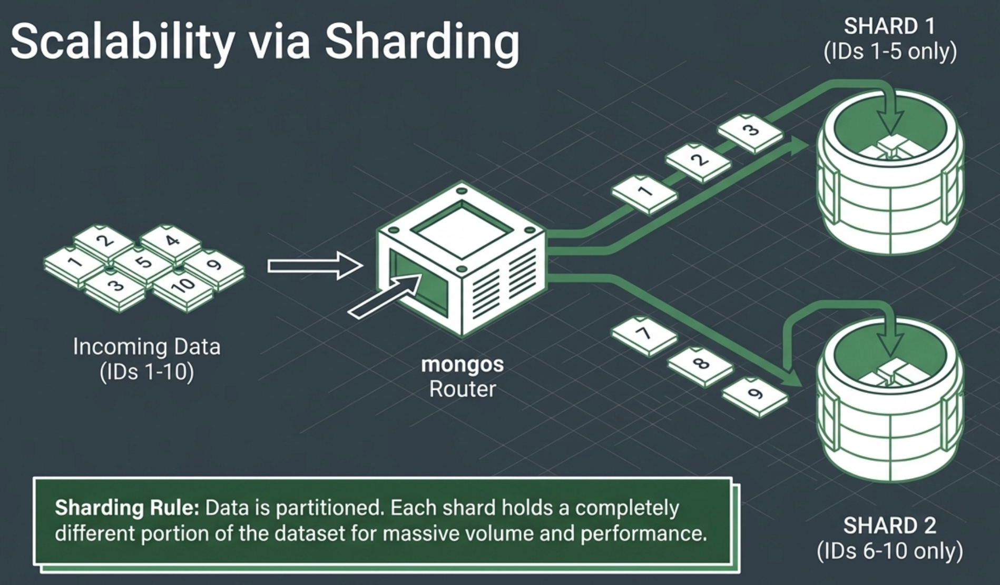


- Data is divided into **shards** — each shard holds a portion of the data
- A **shard key** determines how data is distributed
- A **mongos router** directs queries to the correct shard


---

**Example**

Assume that we have the following docs in table view.

```text

+-----------------------------------------------------------+
|                        PRODUCTS                           |
+----+----------------------+---------+----------------------+
| ID |        name          | price   |      category        |
+----+----------------------+---------+----------------------+
|  1 | Laptop               | 1500.00 | Electronics          |
|  2 | Smartphone           | 999.99  | Electronics          |
|  3 | Headphones           | 199.99  | Electronics          |
|  4 | Monitor              | 300.00  | Electronics          |
|  5 | Keyboard             | 49.99   | Accessories          |
|  6 | Mouse                | 29.99   | Accessories          |
|  7 | Backpack             | 75.00   | Travel               |
|  8 | Water Bottle         | 20.00   | Lifestyle            |
|  9 | Camera               | 650.00  | Electronics          |
| 10 | Tripod               | 120.00  | Accessories          |
+-----------------------------------------------------------+
```

In replication, all nodes have EXACT same documents.
```text
                   REPLICA SET
         (High Availability, NOT data distribution)

            +-----------------------+
            |       PRIMARY         |
            +-----------------------+
            | Docs 1 to 10 (ALL)    |
            +-----------------------+

           /                         \
          /                           \
         v                             v

+-----------------------+   +-----------------------+
|     SECONDARY 1       |   |     SECONDARY 2       |
+-----------------------+   +-----------------------+
| Docs 1 to 10 (ALL)    |   | Docs 1 to 10 (ALL)    |
+-----------------------+   +-----------------------+

**Replica Set Rule:** Every node stores **all documents**.

```
In sharding, the data is partitioned and distributed across multiple shards, so each shard stores only a portion of the
overall dataset, not the full copy.
Each shard is itself normally a Replica Set, so each shard’s data is also replicated internally.

```text
            SHARDED CLUSTER (Data Partitioning)

                      +------------+
                      |  mongos    |
                      |  router    |
                      +------------+
                       /          \
                      /            \
                     v              v

           +--------------------+      +--------------------+
           |      SHARD 1       |      |      SHARD 2       |
           | (IDs 1–5 only)     |      | (IDs 6–10 only)    |
           +---------+----------+      +----------+---------+
                     |                            |
                     v                            v

+-----------------------------------------------------+
|                 SHARD 1 DATA (Replica Set)          |
+----+----------------------+---------+----------------+
| ID | name                 | price   | category       |
+----+----------------------+---------+----------------+
|  1 | Laptop               | 1500.00 | Electronics    |
|  2 | Smartphone           | 999.99  | Electronics    |
|  3 | Headphones           | 199.99  | Electronics    |
|  4 | Monitor              | 300.00  | Electronics    |
|  5 | Keyboard             | 49.99   | Accessories    |
+-----------------------------------------------------+

+-----------------------------------------------------+
|                 SHARD 2 DATA (Replica Set)          |
+----+----------------------+---------+----------------+
| ID | name                 | price   | category       |
+----+----------------------+---------+----------------+
|  6 | Mouse                | 29.99   | Accessories    |
|  7 | Backpack             | 75.00   | Travel         |
|  8 | Water Bottle         | 20.00   | Lifestyle      |
|  9 | Camera               | 650.00  | Electronics    |
| 10 | Tripod               | 120.00  | Accessories    |
+-----------------------------------------------------+

Assume sharding by ID range:
Shard 1 → IDs 1–5
Shard 2 → IDs 6–10
```


## 13. Using a Programming Language to Interact With a Database

Modern applications often need to store, retrieve, and manipulate data dynamically.
To perform these database operations from within an application, database drivers are essential.
These drivers act as a bridge between the programming language and the database management system (DBMS).

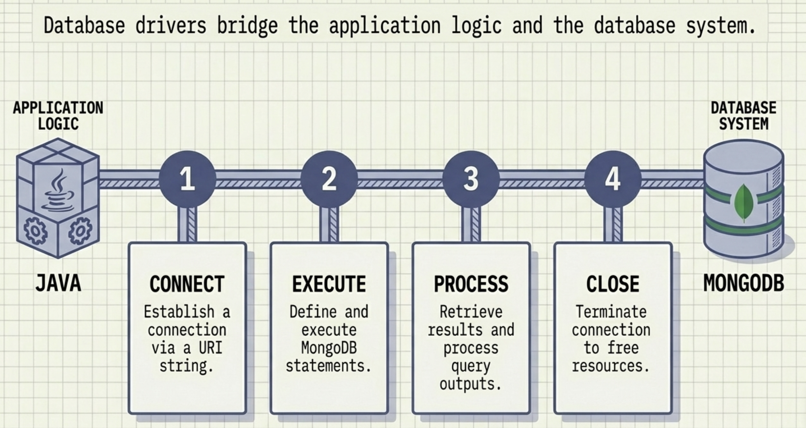

### Database Drivers – Core Functions
Database drivers typically provide the following core capabilities:
- **Establishing a connection** to the database.
- **Executing queries** (e.g., `SELECT`, `INSERT`, `UPDATE`, `DELETE`).
- **Retrieving results** and processing query outputs.
- **Managing transactions** to ensure data consistency.
- **Closing the connection** after operations are completed.


### Initializing A New Project Using IntelliJ IDEA for Java-Based Program Development


To develop a Java program, an IDE and JDK are required.

**IntelliJ IDEA**
- Popular IDE for Java based development.
- Download Link: [IntelliJ](https://www.jetbrains.com/idea/download)
- Install and start IntelliJ IDEA
- File -> New -> Project -> Java
  - give a name, choose a location
  - Build system: **Maven**
  - JDK -> choose a proper JDK, download if not exist
  - check "add sample code" option


#### Loading Database Driver Into The Project Environment

**Load the drivers** using maven package manager.

`pom.xml`

```xml

<?xml version="1.0" encoding="UTF-8"?>
<project xmlns="http://maven.apache.org/POM/4.0.0"
         xmlns:xsi="http://www.w3.org/2001/XMLSchema-instance"
         xsi:schemaLocation="http://maven.apache.org/POM/4.0.0 http://maven.apache.org/xsd/maven-4.0.0.xsd">
    <modelVersion>4.0.0</modelVersion>

    <groupId>cc.ku</groupId>
    <artifactId>java-projects</artifactId>
    <version>1.0-SNAPSHOT</version>

    <properties>
        <maven.compiler.source>17</maven.compiler.source>
        <maven.compiler.target>17</maven.compiler.target>
        <project.build.sourceEncoding>UTF-8</project.build.sourceEncoding>
    </properties>
  
  

    <dependencies>
        <!-- postgresql -->
        <dependency>
            <groupId>org.postgresql</groupId>
            <artifactId>postgresql</artifactId>
            <version>42.7.8</version>
        </dependency>
      
        <!-- mongodb -->
        <dependency>
            <groupId>org.mongodb</groupId>
            <artifactId>mongodb-driver-bom</artifactId>
            <version>5.6.0</version>
            <type>pom</type>
        </dependency>
        <dependency>
            <groupId>org.mongodb</groupId>
            <artifactId>mongodb-driver-sync</artifactId>
            <version>5.6.0</version>
        </dependency>
    </dependencies>
  
  
</project>


```


### Database Operations with Java and PostgreSQL

Java applications can seamlessly interact with PostgreSQL databases using **JDBC** (Java Database Connectivity).  
JDBC is a **standard API** that defines a set of interfaces and classes for connecting to relational databases, 
sending SQL statements, and processing results.

It provides:
- **Connection management**
- **Statement execution**
- **Result retrieval**
- **Error handling and transaction control**

The **PostgreSQL JDBC driver** implements this API and allows Java programs to work directly with PostgreSQL databases.

**Load the drivers** using maven package manager as described in the previous subsection or by using the link:
 [https://jdbc.postgresql.org/download/](https://jdbc.postgresql.org/download/)


#### Example Workflow (Conceptual)
1. **Load the driver**(library or JAR file) in the project environment so that the Java application can 
communicate with the database.
2. **Establish a connection** to the PostgreSQL database using a connection string (URL(socket address), username, and password).
3. **Define and execute SQL statements**.
4. **Process the results** returned by the query.
5. **Close** the statement and connection to free resources.

***The Repository Pattern separates business logic from data access by acting as a bridge between the service/domain layer and
the data source (database, API, or file). 
This abstraction improves maintainability, testability, and supports DIP and OCP.***


**Code Example**


**Define a new role**

The following credentials will be used for all database-related operations throughout the course.

username: lectureuser
password: lecturepassword

```sql
CREATE ROLE lectureuser WITH
  LOGIN
  PASSWORD 'lecturepassword'
  SUPERUSER
  CREATEDB
  CREATEROLE;
```

```sql
CREATE DATABASE inventorydb owner lectureuser;
```

```sql
CREATE TABLE products (
    id SERIAL PRIMARY KEY,
    name VARCHAR(100) NOT NULL,
    price DOUBLE PRECISION CHECK (price >= 0)
);
```


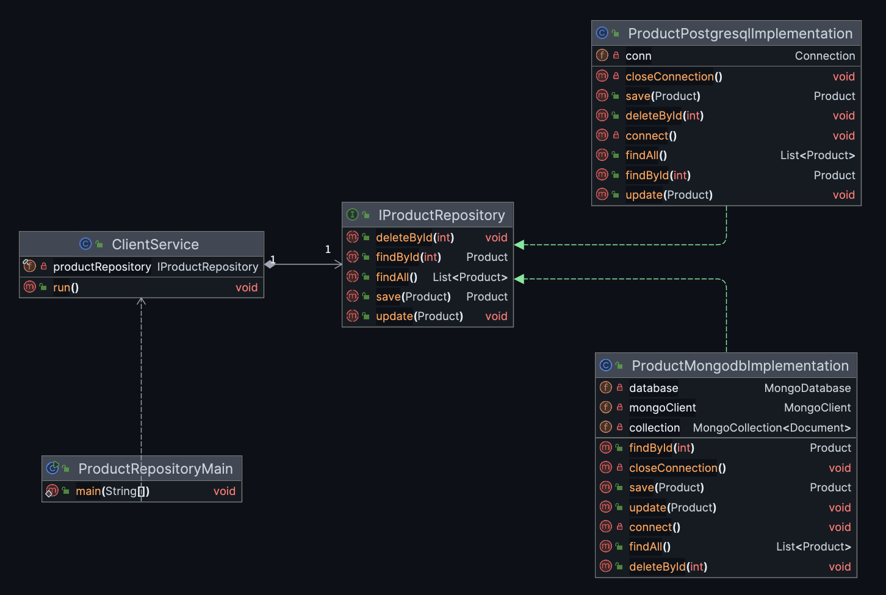

>[ProductRepositoryMain.java](./repository/ProductRepositoryMain.java) | [IProductRepository.java](./repository/IProductRepository.java) | [ClientService.java](./repository/ClientService.java) | [Product.java](./repository/Product.java) | [ProductPostgresqlImplementation.java](./repository/ProductPostgresqlImplementation.java) | [ProductMongodbImplementation.java](./repository/ProductMongodbImplementation.java)


### Database Operations with Java and MongoDB

You can use MongoDB Cloud (https://account.mongodb.com/account/login
) without installation, or install MongoDB on your computer from the following 
link: https://www.mongodb.com/try/download/community

#### Example Workflow (Conceptual)
1. **Load the drivers** using maven package manager as described in the previous subsection.


`pom.xml`
```xml

<?xml version="1.0" encoding="UTF-8"?>
<project xmlns="http://maven.apache.org/POM/4.0.0"
         xmlns:xsi="http://www.w3.org/2001/XMLSchema-instance"
         xsi:schemaLocation="http://maven.apache.org/POM/4.0.0 http://maven.apache.org/xsd/maven-4.0.0.xsd">
    <modelVersion>4.0.0</modelVersion>

    <groupId>cc.ku</groupId>
    <artifactId>java-projects</artifactId>
    <version>1.0-SNAPSHOT</version>

    <properties>
        <maven.compiler.source>17</maven.compiler.source>
        <maven.compiler.target>17</maven.compiler.target>
        <project.build.sourceEncoding>UTF-8</project.build.sourceEncoding>
    </properties>

    <dependencies>
        <!-- postgresql -->
        <dependency>
            <groupId>org.postgresql</groupId>
            <artifactId>postgresql</artifactId>
            <version>42.7.8</version>
        </dependency>
        <!-- mongodb -->
        <dependency>
            <groupId>org.mongodb</groupId>
            <artifactId>mongodb-driver-bom</artifactId>
            <version>5.6.0</version>
            <type>pom</type>
        </dependency>
        <dependency>
            <groupId>org.mongodb</groupId>
            <artifactId>mongodb-driver-sync</artifactId>
            <version>5.6.0</version>
        </dependency>
      
    </dependencies>
</project>


```
2. **Establish a connection** to the MongoDB database using 
a connection string (URL(socket address), username, and password).
3. **Perform db operations**.
4. **Process the results** returned by the query.
5. **Close** the connection.


**Code Example**

* Define `inventorydb.products` collection.


>[ProductRepositoryMain.java](./repository/ProductRepositoryMain.java) | [IProductRepository.java](./repository/IProductRepository.java) | [ClientService.java](./repository/ClientService.java) | [Product.java](./repository/Product.java) | [ProductPostgresqlImplementation.java](./repository/ProductPostgresqlImplementation.java) | [ProductMongodbImplementation.java](./repository/ProductMongodbImplementation.java)


***
## Hands-on Exercise

1. Define the `inventorydb` database and `products` table in `PostgreSQL`, using the SQL statements provided above the 
Class Diagram.
2. Define `inventorydb.products` collection in `MongoDB`.
3. Initialize a new project with Maven support.
4. Include the necessary database drivers for PostgreSQL and MongoDB operations.
5. Define a package named `cc.ku.ict.module5.exercises.exercise1`.
6. Run the program given above that performs operations on the  PostgreSQL database (Check the db connection parameters).
7. Discuss how you can also add MariaDB support to the application without modifying the algorithm in the `ClientService`.
8. Define `findByName(String name)` and `findByPrice(double price)` methods in the product repository and modify 
the `ClientService` accordingly to test these methods.
***
