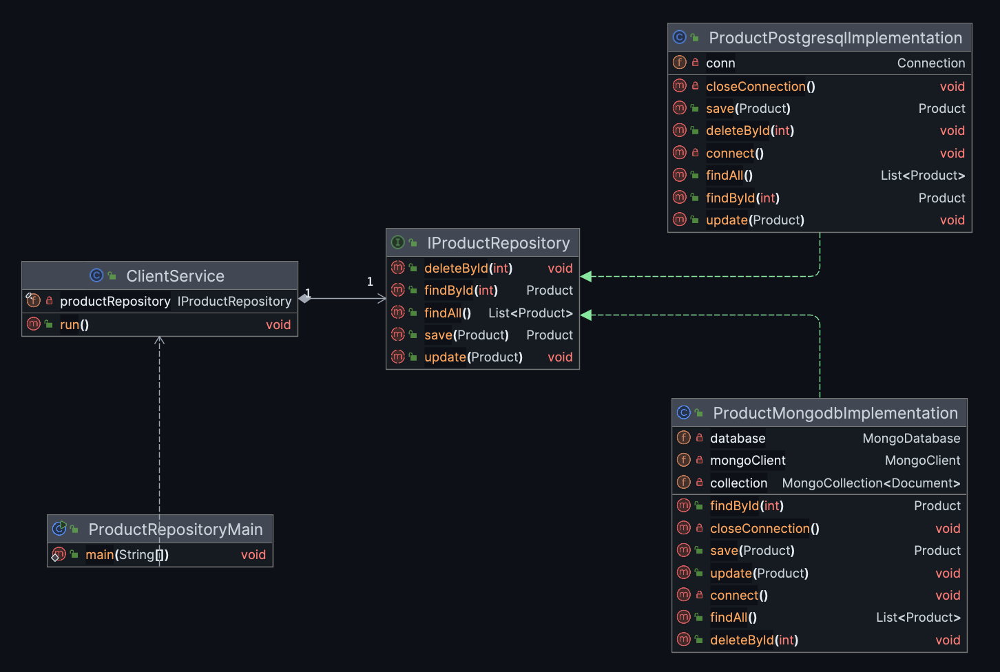

# Hands-on Exercise 1

You are expected to develop the following application:




## Tasks

---

1. Define the `inventorydb` database and `products` table in `PostgreSQL`, using the following SQL statements:

**Define a new role**

The following credentials will be used for all database-related operations throughout the course.

username: lectureuser
password: lecturepassword

```sql
CREATE ROLE lectureuser WITH
  LOGIN
  PASSWORD 'lecturepassword'
  SUPERUSER
  CREATEDB
  CREATEROLE;
```

```sql
CREATE DATABASE inventorydb owner lectureuser;
```

```sql
CREATE TABLE products (
    id SERIAL PRIMARY KEY,
    name VARCHAR(100) NOT NULL,
    price DOUBLE PRECISION CHECK (price >= 0)
);
```

---

2. Define `inventorydb.products` collection in `MongoDB`.

You can use MongoDB Cloud (https://account.mongodb.com/account/login
) without installation, or install MongoDB on your computer from the following
link: https://www.mongodb.com/try/download/community

---

3. Initialize a new java project with Maven support using IntelliJ IDEA.

- File -> New -> Project -> Java
   - give a name, choose a location
   - Build system: **Maven**
   - JDK -> choose a proper JDK, download if not exist
   - check "add sample code" option


4. Load Database Drivers Into The Project Environment


**Load the drivers** using maven package manager.

`pom.xml`

```xml

<?xml version="1.0" encoding="UTF-8"?>
<project xmlns="http://maven.apache.org/POM/4.0.0"
         xmlns:xsi="http://www.w3.org/2001/XMLSchema-instance"
         xsi:schemaLocation="http://maven.apache.org/POM/4.0.0 http://maven.apache.org/xsd/maven-4.0.0.xsd">
    <modelVersion>4.0.0</modelVersion>

    <groupId>cc.ku</groupId>
    <artifactId>java-projects</artifactId>
    <version>1.0-SNAPSHOT</version>

    <properties>
        <maven.compiler.source>17</maven.compiler.source>
        <maven.compiler.target>17</maven.compiler.target>
        <project.build.sourceEncoding>UTF-8</project.build.sourceEncoding>
    </properties>
  
  

    <dependencies>
        <!-- postgresql -->
        <dependency>
            <groupId>org.postgresql</groupId>
            <artifactId>postgresql</artifactId>
            <version>42.7.8</version>
        </dependency>
      
        <!-- mongodb -->
        <dependency>
            <groupId>org.mongodb</groupId>
            <artifactId>mongodb-driver-bom</artifactId>
            <version>5.6.0</version>
            <type>pom</type>
        </dependency>
        <dependency>
            <groupId>org.mongodb</groupId>
            <artifactId>mongodb-driver-sync</artifactId>
            <version>5.6.0</version>
        </dependency>
    </dependencies>
  
  
</project>


```

5. Define a package named `ku.ict.module5.exercises.exercise1` and download the application in `~/module5/repository` here.

6. Run the application for both PostgreSQL and MongoDB support.

7. Debug your application. Your debugging should include:

- At least one **breakpoint**
- Use of **Step Over**, **Step Into**, and **Step Out**
- Inspection of variables using the **Variables panel** or **Watches**


8. Define `findByName(String name)` and `findByPrice(double price)` methods in the product repository and modify
   the `ClientService` accordingly to test these methods.

## Reflection Question
1. how can you add MariaDB support to the application without modifying the algorithm in the `ClientService`.

